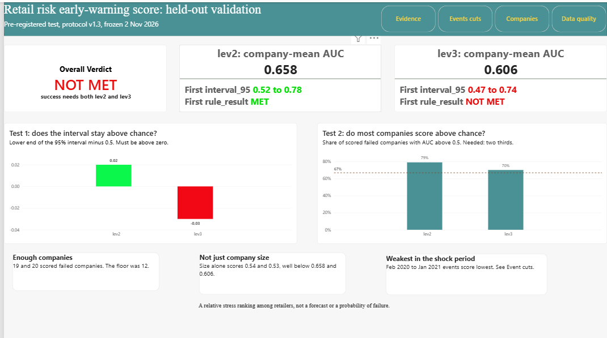
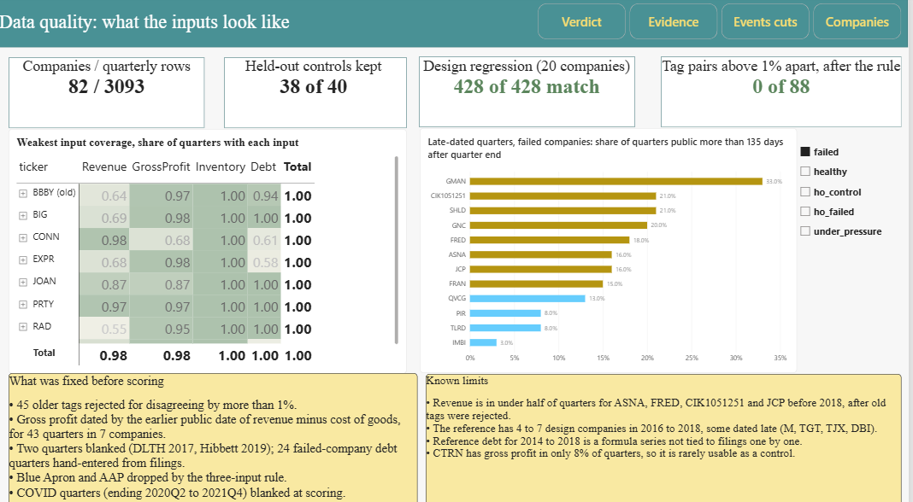
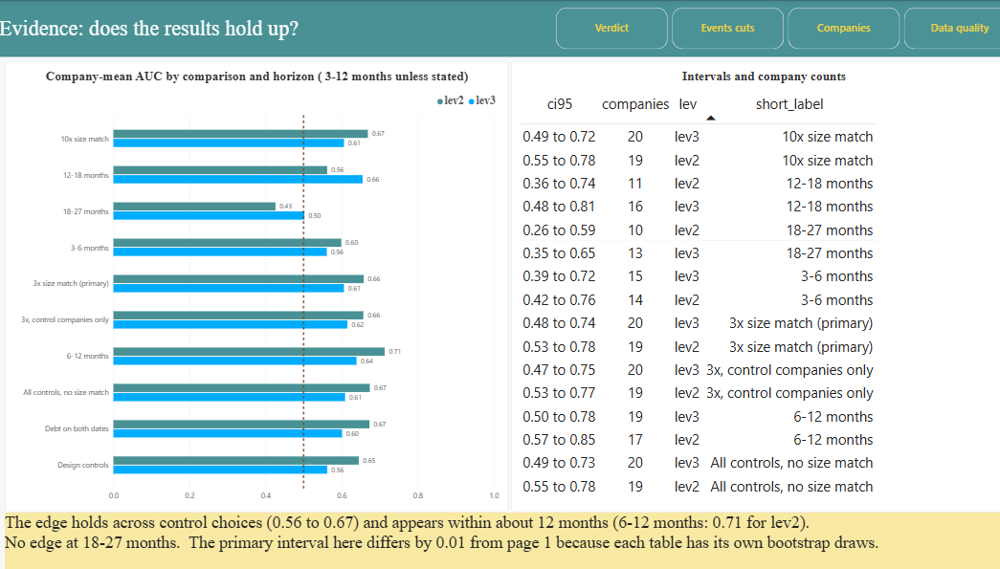
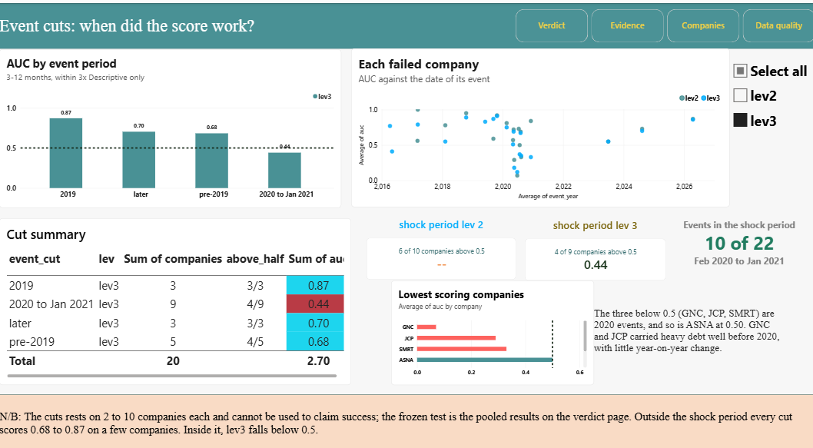
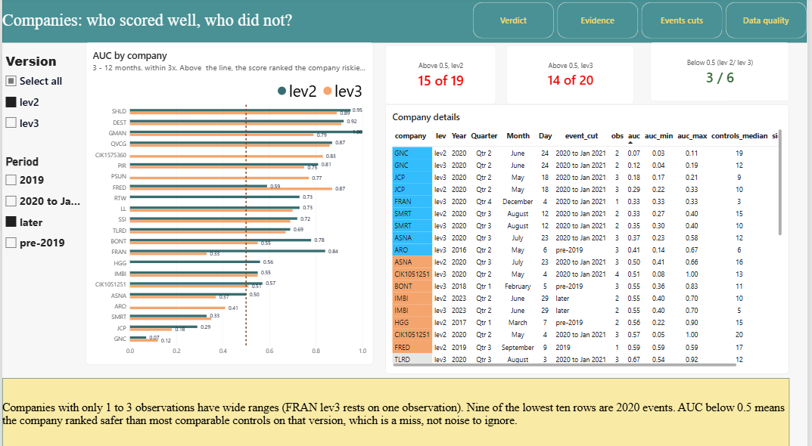

<div align="center">


**An early-warning scorecard for US retailers, built from SEC EDGAR filings, tested on companies it had never seen, and reported honestly.**


</div>

---

## ⏱️ In 60 seconds

> 📄 **Read next:** [one-page summary (PDF)](docs/executive_summary.pdf) · [methodology](docs/methodology.md) · [data dictionary](docs/data_dictionary.md) · [run order](RUN_ORDER.md)

- **Question.** Do simple, public financial signals (gross margin, inventory build-up, leverage) rank US retailers by distress risk *before* they fail?
- **What I built.** A data pipeline that turns raw SEC filings into clean, dated quarterly data for **82 retailers** (3,093 company-quarters), a transparent three-signal score, and a five-page Power BI report on a MySQL layer.
- **How I tested it.** I wrote the test down first and froze it with a SHA-256 hash (`781fe9b6…`). Then I ran it once on **22 retailers that later failed** and **38 healthy controls** that were never used to design the score.
- **Result.** Partial evidence. One of two pre-registered versions passes, narrowly (AUC **0.658**, interval 0.52 to 0.78). The other does not (AUC **0.606**, interval 0.47 to 0.74). The pre-registered verdict is **NOT MET**.
- **Why it matters.** A model that survives a frozen, held-out test is rare. A modest, honestly reported result is more useful to a decision-maker than an impressive in-sample number.

| | lev2 (change in debt / sales) | lev3 (% change in debt) |
|---|---|---|
| Scored failed companies (floor: 12) | 19 | 20 |
| Company-mean AUC | **0.658** | **0.606** |
| 95% interval (two-way bootstrap) | 0.52 to 0.78 | 0.47 to 0.74 |
| Companies above 0.5 | 15 of 19 | 14 of 20 |
| Size-only benchmark | 0.540 | 0.534 |
| Pre-registered rule | 🟢 **MET, narrowly** | 🔴 **NOT MET** |

> [!IMPORTANT]
> This is a *relative stress ranking among retailers*. It is not a forecast and not a probability of failure.



---

##  1. Problem statement

US retailers run on thin margins, heavy inventory and large lease and debt commitments. When consumer demand weakens, the pressure builds in the accounts well before a bankruptcy filing. But two things make it hard to turn that into a reliable early warning:

1. **Hindsight is easy.** Most studies of failed companies choose the failures after the fact, use data that was not yet public at the time, and report the score that worked. The result looks better than it would have in real time.
2. **Filing data is messy.** The same concept carries different tags across companies, tags change meaning mid-series, restatements overwrite history, and failed companies file late or not at all.

**The question:** using only information that was public on each date, do gross-margin, inventory and leverage signals rank retailers that later failed as riskier than healthy retailers, and how confident can we be in the answer?

##  2. Business objective

Give a credit, supplier-risk or equity-research team a **transparent, reproducible way to triage retailers by early financial stress**, and an honest statement of how far to trust it.

Specifically:

| Objective | Deliverable |
|---|---|
| Build a defensible dataset from public filings | A documented, regression-tested pipeline: 82 companies, 3,093 quarterly rows |
| Define a simple score a risk analyst can explain | Three signals, equal weights, percentile-ranked against a fixed reference group |
| Measure whether it works out of sample | A frozen protocol and a one-shot test on 22 failed companies and 38 controls |
| Put the evidence in front of decision-makers | A five-page Power BI report on a MySQL layer, with a pre-registered verdict |
| State the limits plainly | Robustness checks, event-period cuts, and a data-quality page |

## 3. Approach

 ➜  ➜  ➜  ➜  ➜ 

### The score

Three signals, each converted to a percentile against a fixed reference group of 12 design companies on the same date, then averaged with equal weights:

| Signal | Meaning | Riskier when |
|---|---|---|
| `gm_chg_yoy` | Year-on-year change in gross margin | lower |
| `inv_gap` | Inventory growth minus sales growth | higher |
| leverage | `lev2`: change in debt / trailing four-quarter sales; `lev3`: % growth in debt | higher |

Rules fixed before scoring: a quarter is used only from its **public date**, a company's latest public quarter may be at most **135 days old**, at least 5 reference companies are needed, and quarters ending 2020Q2 to 2021Q4 (COVID) are blanked.

### The discipline that makes the result credible

- **As-of dating.** Each quarter becomes usable on the latest filing date among its inputs. A leakage audit found **0 of 62** scored observations dated on or after the event filing.
- **Pre-registration.** Success criteria, the control rule (within 3x of the failed company's sales), the minimum sample (12 scored failures per version) and the reading rules were fixed and hashed before any held-out score existed. The test ran twice on the same day, with identical output; the repeat is logged, not hidden.
- **No tuning on the test set.** The equal weights were set in advance. Re-weighting on the same eight design failures would only have fitted them.
- **Reading rules for ambiguity**, fixed beforehand: which interval decides the verdict, how early quarters count as extra negatives, and that the four event-period cuts are descriptive only.

## 4. Tools and techniques

| | Area | What I used |
|---|---|---|
| 🏛️ | Data source | SEC EDGAR XBRL `companyfacts` API; filing text for hand checks |
| 🐍 | Pipeline and analysis | Python (pandas, NumPy, SciPy), run in Google Colab with data on Google Drive |
| 🗄️ | Database | MySQL (SQLAlchemy and PyMySQL loader; tables plus SQL views) |
| 📊 | Reporting | Power BI Desktop: DAX measures, conditional formatting, page navigation, hidden pages |
| 📈 | Statistics | AUC (Mann-Whitney), two-way bootstrap (2,000 draws, fixed seed), event-year clustered bootstrap, sign and binomial tests, leave-one-company-out, ablation, control-group sensitivity |
| 🛠️ | Data engineering | Earliest-filed-value rule, Q4 derivation (annual minus three quarters), tag stitching with a 1% agreement rule, per-company debt formulas, regression test against earlier outputs |
| 🔁 | Reproducibility | Protocol hash, run logs, seeded randomness, versioned scripts |

##  5. Data and scope

- **Design sample (20 retailers):** 6 healthy (WMT, COST, TGT, HD, TJX, ROST), 6 under pressure (KSS, M, WOOF, DBI, BGFV, PLCE), 8 failed (BBBY, BIG, CONN, EXPR, JOAN, PRTY, RAD, TUEM). Used to design and stress-test the score.
- **Held-out sample:** 22 failed retailers and 38 controls (40 candidates, 2 dropped by the three-input rule), plus 36 documented exclusions. Never used to design the score.
- **Eleven core metrics** that every retailer reports: revenue, cost of goods, gross profit, inventory, total debt, current assets, current liabilities, equity, net income, operating cash flow, capex.
- **Period:** quarterly history from 2014; failure events through 2024.



##  6. Key insights

###  6.1 Data and EDA insights (what the raw files taught me)

1. **Period labels lie.** The SEC's `fy`/`fp` fields describe the *filing*, not the data point. The same balance-sheet date appeared under two different fiscal labels. Periods are identified by end date and length instead.
2. **Look-ahead bias is the biggest hidden risk.** Bed Bath & Beyond's last 10-K was filed on 14 June 2023, after its April 2023 bankruptcy. Using it would have claimed warning signs "visible beforehand" from numbers nobody had yet. Every score uses the public date.
3. **Keying on tickers breaks.** The old Bed Bath & Beyond CIK now belongs to a shell with another name, and the ticker's CIK belongs to a different company. Everything is keyed on CIK.
4. **The same concept hides under many tags, and tags change meaning.** Revenue has three tag families; Designer Brands' `LongTermDebt` excluded current maturities in 2020-21; Children's Place moved its revolver between tags. A per-company tag map plus a 1% agreement rule for stitching (45 tags rejected; 88 overlapping pairs audited, 0 above 1%) prevents fake jumps.
5. **Double counting is easy and silent.** A reconciliation of 495 company-quarters of debt found three formulas that counted one balance twice (Express, Big Lots, Children's Place), inflating debt by up to 100%. A Walmart tag silently excluded short-term borrowings worth up to 24% of its debt.
6. **My own proposals were wrong, and the filing check caught it.** Checking 18 automatically proposed debt formulas against the filings, 11 held, **6 were wrong** (they omitted a revolver, a current portion or a related-party loan) and 1 could not be verified. The errors leaned against the score, so I fixed them rather than call them conservative.
7. **Apparent gaps were calendar artifacts.** Sears, Fred's and Destination Maternity looked like missing data; the real cause was a 53-week fiscal year. Matching year-earlier quarters by date with a tolerance recovered them.
8. **Failed companies file late.** Median days to public date for failed companies is 32 to 58, and up to 33% of one company's quarters were public more than 135 days after quarter end. A gross-profit date rule corrected 43 quarters in 7 companies by a median of about 200 days.
9. **COVID dominates raw comparisons.** Debt rose 14% or more in the quarter to May 2020 at 10 of 12 comparable companies. Without a rule for 2020, every group average would measure the pandemic, not distress. Those quarters are blanked.
10. **Regression discipline.** After every pipeline change, the 20 design companies reproduce their earlier values: **428 of 428** quarters unchanged.

###  6.2 Design-phase findings (hypotheses, tested in-sample on 8 failed companies)

| Hypothesis | Outcome |
|---|---|
| H1: margins fall and leverage rises before failure | 🟡 **Suggestive for leverage** (6 to 7 of 8 in the predicted direction); weak for gross margin and for the joint result |
| H2: inventory outgrows sales before failure | 🔴 **Not supported as stated** (5 of 8; the pattern split into inventory building and inventory shrinking) |
| H3: a composite score ranks failing companies as riskier | 🟢 **Modest ranking power in the last year**: mean AUC 0.68 to 0.72 in the last four quarters; fades earlier (0.55 to 0.64, interval includes 0.5) |
| H4: late filing is an early warning | 🔴 **Not supported** (median delay change was 0 for almost every company) |

Three things stood out:

- **Leverage carried the score.** Alone, leverage scored 0.79 (lev2) and 0.71 (lev3); gross margin, inventory gap and filing delay were near coin flips (0.58 to 0.60).
- **The comparison group matters, and size is a trap.** Against healthy-only controls the AUC rose to about 0.81 (0.87 to 0.91 in the later as-of re-test). But company size alone scored even higher against those six large retailers (about 0.98), and against controls matched to within 10x of size the score's AUC fell to 0.56 to 0.59. That is why the held-out test uses size-matched controls and prints a size-only benchmark beside every result.
- **Robust to single companies.** Leaving out any one failed company never collapsed the AUC toward 0.5.

###  6.3 The held-out verdict (22 failed companies, 38 controls, run once)

| Finding | Result |
|---|---|
| Pre-registered verdict | 🔴 **NOT MET** (lev2 met narrowly, lev3 not met) |
| Shrinkage from design to test | In-sample 0.683 / 0.704 became **0.658 / 0.606** out of sample, the expected direction, and larger for lev3 |
| Where it works | Within about 12 months of the event. lev2 AUC by horizon: 0.599 (3 to 6 months), **0.713 (6 to 12)**, 0.562 (12 to 18), 0.426 (18 to 27) |
| Not a size effect | Size alone scores 0.540 and 0.534 |
| Leverage does the work | Ablation (lev2 / lev3): leverage only 0.694 / 0.602; gross margin only 0.582 / 0.548; inventory gap only 0.556 / 0.562 |
| Weakest in the shock period | Events from Feb 2020 to Jan 2021: lev2 0.554, lev3 0.442. Pre-2019: 0.822 / 0.683; later: 0.719 / 0.703 |
| False positives are common | 26% (lev2) and 34% (lev3) of controls score above the failed median |
| Robust to the setup | lev2 stays 0.645 to 0.674 across four alternative control sets and a debt-on-both-dates check (lev3: 0.562 to 0.615) |
| Misses | GNC, JCP and SMRT score below 0.5 for lev2 (ASNA at 0.50) |

> [!NOTE]
> An untested hypothesis, labelled as one: the score uses *changes* in leverage and ignores the *level* of debt, which may explain the weaker lev3 result. Testing it needs fresh data, because the held-out sample is now used.

##  7. The Power BI report

Five pages on a MySQL layer (`retail_risk`), with buttons for navigation and pages 2 to 5 hidden from the tab bar.

| Page | What it answers |
|---|---|
| **1. Verdict** | Did the pre-registered rule pass? Overall and per version, with the two tests (interval above chance, two thirds of companies above 0.5) shown as charts |
| **2. Evidence** | How robust is the result? Alternative control sets, horizons and a signal-by-signal ablation |
| **3. Event cuts** | Does it hold across periods? Four descriptive cuts and a per-company scatter by event date |
| **4. Companies** | Which failed companies were ranked well and which were missed |
| **5. Data quality** | Input coverage by company, late-dated quarters, what was fixed before scoring, and the known limits |





## 8. Business recommendations

Split by how much the evidence supports each one.

### Supported by the held-out test

1. **Use the score for triage, not for decisions.** It ranks retailers by relative stress; it does not give a probability or a date. Use it to decide *where to look first*, then apply judgement and a filing read.
2. **Weight the time window.** Signal strength peaks 6 to 12 months before the event (lev2 AUC 0.71) and is close to chance beyond 18 months. Review top-ranked names every quarter, not once.
3. **Lead with the leverage-change signal.** It carries the score (0.694 alone, against 0.58 and 0.56 for margin and inventory gap). Do not rely on gross margin or inventory gap on their own.
4. **Expect false alarms and plan for them.** About one in four to one in three healthy retailers will score above the typical failed company. Pair any flag with a second check before action.
5. **Pause or separate the score during macro shocks.** It was weakest for events from Feb 2020 to Jan 2021. In a shock period, treat the ranking as unreliable until peers have normalised.

###  Worth acting on in the data process

6. **Score from the public date, never the period end.** Any monitoring built on period-end data will overstate how early the warning was. Build the as-of logic first.
7. **Reconcile debt against filings before trusting any leverage signal.** In this project 6 of 18 automatically proposed debt formulas were wrong, and the errors changed the signal's direction for some failed companies.
8. **Track late filing as a data-quality flag**, not as a predictor. In the design sample, filing delay carried no signal; but late filings do make the data unusable in real time.

###  Hypotheses to test next (not yet evidence)

9. **Add a level-based leverage and liquidity signal.** The score ignores how much debt a company carries. Test this on fresh data under a new pre-registered protocol (v2), not on the held-out sample used here.
10. **Run a forward test.** The repository already records live scores in an append-only, hashed ledger (`forward_test_ledger.csv`). Compare them with actual failures after 12 months. This is a true out-of-sample test and costs nothing but time.

##  9. Limitations

- **Small sample:** 19 to 20 scored failures per version; wide intervals. lev2's lower bound is 0.52, a narrow pass.
- **Weak in the shock period** and thin before 2019 (4 to 7 reference companies in 2016 to 2018, some dated late: M, TGT, TJX, DBI).
- **Coverage gaps:** revenue is present in under half of quarters for ASNA, FRED, CIK1051251 and JCP before 2018, after old tags were rejected; CTRN has gross profit in only 8% of quarters.
- **Design debt for 2014 to 2018** is a formula series not tied to filings one by one.
- **Survivorship in the control universe:** retailers with March to November year-ends are under-represented.
- **Two early inventory values** for one control-universe failure (CIK1575360) look like extraction artifacts and are still under review.
- **The held-out sample is spent.** Any change to the score needs new data and a new protocol.

## 📁 10. Repository

```
README.md
RUN_ORDER.md  which script to run, in what order, with what inputs and outputs
requirements.txt
pipeline/     heldout_pipeline.py (v6), audit_asof.py
protocol/     frozen protocol v1.3 + SHA-256, generator script
test/         step44_test.py (the frozen test), step45_export.py (read-only report extras)
sql/          load_to_mysql.py, views.sql, view scripts
powerbi/      retail_risk.pbix, design_mockups/
scripts/      step scripts in run order (design phase, held-out selection)
docs/         executive_summary.pdf, methodology.md, data_dictionary.md,
              findings notes, page screenshots (docs/images/)
data/         not stored; see data/README.md
```

### ▶️ Reproduce

1. Run `pipeline/heldout_pipeline.py` in Google Colab (input: SEC `companyfacts`). The built-in regression check must print PASS (428 of 428).
2. Confirm the SHA-256 of `protocol/heldout_protocol_v1_3.md` is `781fe9b663d973a9b157eb26eaef453f26268...`.
3. Run `test/step44_test.py` (it verifies the hash before scoring), then, optionally, `test/step45_export.py` (read-only extras; it refuses to export unless it reproduces the frozen result, and on my data it currently does not: 184 vs 187 observations, under investigation. The frozen results above come from step 44 and do not depend on it).
4. Edit the data folder and credentials in `sql/load_to_mysql.py`, run it, then run the view scripts in MySQL Workbench.
5. Open `powerbi/retail_risk.pbix`, point it at your MySQL server and refresh.

Expected: lev2 🟢 **MET**, lev3 🔴 **NOT MET**, overall 🔴 **NOT MET**. Full details and checks: [RUN_ORDER.md](RUN_ORDER.md).

## 🏆 11. What this project demonstrates

| Skill | Evidence in this repository |
|---|---|
| Data engineering on messy public data | Tag stitching, as-of dating, Q4 derivation, regression-tested pipeline (428/428) |
| Data quality judgement | Caught double counting, a 53-week artifact, six wrong debt formulas, and look-ahead bias before they reached a result |
| Statistical rigour | Pre-registered protocol, held-out test, two-way and clustered bootstrap, ablation, leave-one-out |
| Intellectual honesty | A NOT MET verdict reported as such; hypotheses labelled as hypotheses; corrections documented |
| SQL and BI | MySQL schema and views; five-page Power BI report with DAX, navigation and conditional formatting |
| Communication | Plain-language findings, limitations stated up front, recommendations tied to evidence |

##  Data source

SEC EDGAR XBRL `companyfacts`, accessed in 2026.

## 👤 About me

**[Ivone Atieno]** · [Data analyst] · [https://linkedin.com/in/ivone-atienoo] · [ivoneatieno325@gmail.com] 
